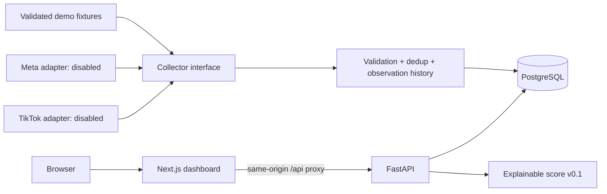

# DROPSpy Radar v0.1 architecture

- `apps/web`: Next.js App Router, TypeScript, Tailwind, responsive client dashboard. Same-origin proxy avoids browser CORS configuration; API_URL is bound during production build.
- `apps/api/app/collectors`: typed normalized records, protocol, deterministic demo adapter; distinct fail-closed Meta/TikTok extension points. Live adapters make no requests. A future adapter must document authorization, geography/coverage, provenance, quotas, timeouts and allowed hosts before activation. Access denial/CAPTCHA is terminal, never a retry trigger.
- `ingest.py`: transaction per batch. Natural identity `(platform, source_id, is_demo)`; SHA-256 dedup for creative text per ad; observation identity `(ad_id, observed_at)`. Chronology prevents stale observations overwriting current status. Serialized ingestion only in this MVP; concurrent workers require upsert/locking.
- `models.py`: portable SQLAlchemy schema, PostgreSQL in Compose and SQLite for isolated unit tests. Database-generated IDs; foreign keys; indexed platform, advertiser, country, domain and demo partition. Tables: ads → creatives / observations. `create_all` bootstraps v0.1 only; versioned migrations required before schema evolution.
- Startup seeds the demo dataset idempotently. Production data is never returned by demo endpoints and vice versa. `MODE=live` starts empty with no automatic collector. Fixture source/landing URLs use reserved example domains and are not actual ads.
- Saved ads are persisted on the ad row for this single-user MVP. Competitor view summarizes stored advertiser observations; scheduled watchlists are deferred. Product Intelligence exposes per-ad signal explanations, not cross-ad product clustering.

## Score v0.1

| Input | Weight | Evidence / confidence outside DEMO |
| --- | ---: | --- |
| Observation span | 40 | min(days / 60, 1), stored first/last seen, medium; not proof of continuous delivery |
| Creative variants | 25 | min(unique text fingerprints / 5, 1), medium; not visual similarity |
| Advertiser recurrence | 20 | min(ads by same advertiser / 5, 1) in current data partition, low; names may collide |
| Landing quality proxy | 15 | HTTPS URL scheme, low; no content, speed, checkout or trust audit |

Scores have individual source, evidence and confidence; all DEMO metrics have demo confidence. Missing business outcomes are not inferred. No ROAS, revenue or sales estimates. HTTP landing URLs receive 0 for landing proxy. Score is dataset-dependent and is not a probability of product success.

## Next milestones

1. Authorized provider selection and contract/coverage review (US then EU); licensed fixture integration; bounded HTTP timeouts and Retry-After handling for transient 429/5xx, terminal 401/403/CAPTCHA.
2. Alembic migrations, concurrency-safe upserts, authenticated multi-user collections, scheduler and advertiser identity normalization.
3. Product clustering, landing audits with SSRF protections, source coverage indicators, Playwright UI regression suite.

No endpoint fetches arbitrary landing URLs. Local-only host bindings; no authentication in v0.1. Add authentication, CSRF/session protections, quotas and access controls before internet exposure.
