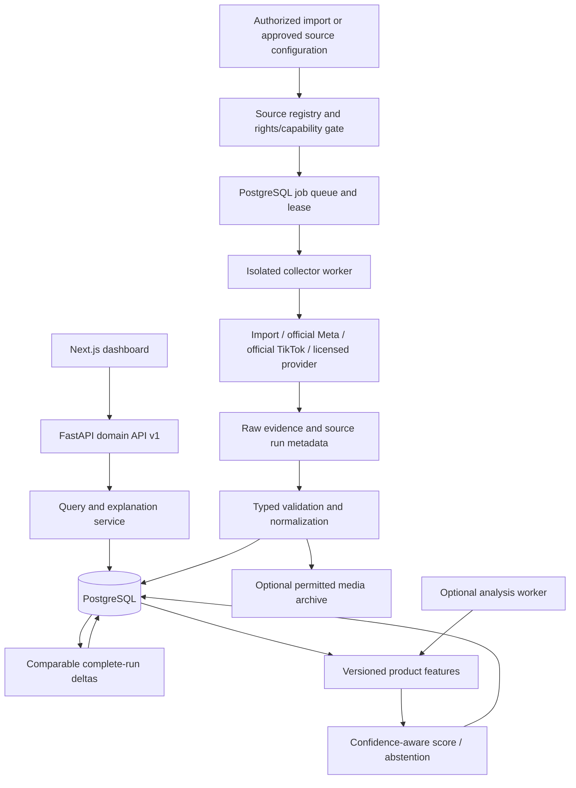

# Architecture Blueprint — proposed v0.2

**Chỉ thiết kế.** Baseline v0.1 không đổi: Next.js + TypeScript/Tailwind → same-origin FastAPI → PostgreSQL, demo seed + explicit disabled Meta/TikTok adapters [D1](REPOSITORY_AUDIT.md#d1) [D2](REPOSITORY_AUDIT.md#d2) [D4](REPOSITORY_AUDIT.md#d4) [D5](REPOSITORY_AUDIT.md#d5) [D6](REPOSITORY_AUDIT.md#d6). Phase 2 không thêm dependency/runtime service, không chạy upstream source và không đổi score hiện hành.

## Mục tiêu và ranh giới

- Dashboard/AI chỉ đọc normalized domain API, không import provider schema hoặc tự gọi external ad APIs.
- Collector có thể thay mà không thay UI, score engine hoặc database identity. Provider-specific raw fields nằm trong evidence object có version, không rải aliases qua frontend.
- Paid ad, organic post, selected Top Ads, transparency sample và DEMO là corpus riêng. Source capabilities tuyên bố quyền, query support, geography, field coverage và retention; interface lấy ý tưởng problem-space từ A nhưng viết mới vì license hold [A1](REPOSITORY_AUDIT.md#a1) [A11](REPOSITORY_AUDIT.md#a11).
- Local/import-first MVP không bắt buộc Redis/Celery/vector DB/LLM/S3. PostgreSQL đủ jobs + observations; filesystem archive optional cho dữ liệu được phép. Scale sau khi đo workload.



Official/live adapters trong sơ đồ là **planned, gated**, không đã được triển khai/approved. AI output không ghi đè source facts.

## Module boundaries và thư mục dự kiến

```text
apps/api/app/
  domain/          # Ads, creatives, advertisers, products, observations, unknown semantics
  sources/         # SourceCapabilities, approved scopes, terms metadata
  collectors/
    base.py        # Typed Query / PageResult / error contract
    demo.py        # Keep explicit demo fixtures
    import_file.py # First real-data path, operator-authorized dataset
    meta_official.py   # Gated future adapter written from official docs
    tiktok_official.py # Gated future adapter written from official docs
    providers/     # Optional licensed vendors, no automatic fallback
  ingest/          # Normalize, provenance, transaction/upsert, quarantine
  jobs/            # Queue/lease/scheduler, checkpoint, budget policy
  intelligence/    # Landing grouping, creative identity, features, explanation
  api/             # Stable query/DTO routes
  migrations/      # Alembic reviewed migrations, no production create_all evolution
apps/web/          # Keep seven-view dashboard; capability-aware controls
storage/           # Ignored local evidence/media, policy-controlled retention
```

Đây không phải yêu cầu tạo ngay toàn bộ thư mục. Refactor dần, giữ compatibility routes v0.1 cho đến khi fixtures/contract tests xác nhận.

## Collector contract (pseudo-interface, chưa code)

```text
SourceCapabilities:
  source_id, source_kind, adapter_version, corpus_kind
  approved_purposes, approved_markets, approved_until, rights_reference
  supported_query_fields, supported_fields, required_credentials_names
  cursor_semantics, rate_policy, maximum_page_size, retention_policy
  collection_completeness_semantics, media_archive_allowed

collect_page(query, checkpoint, run_context) -> PageResult:
  records: list[NormalizedAdObservation]
  next_checkpoint: opaque | null
  outcome: success | empty | partial | denied | rate_limited | schema_error
  query_fingerprint, source_as_of, fetched_at
  reported_total: int | null
  truncated: bool, exhaustive_for_query: bool | unknown
  cost: reported amount | null
  warnings: typed list
```

- Unknown/unsupported filters trả 422 `unsupported_query_capability`, không silently ignore như một số paths của A [A6](REPOSITORY_AUDIT.md#a6) [A11](REPOSITORY_AUDIT.md#a11). UI disable/label filter theo source, API vẫn validate server-side.
- `query_country` không là reached country hoặc country of advertiser. Query theo date phải nêu field/source semantics; nguồn không hỗ trợ query filter có thể hỗ trợ **local stored-data filter**, UI phân biệt.
- `source_kind`: official_api / licensed_provider / authorized_file / permitted_public_page / demo. `permitted_public_page` yêu cầu xác minh riêng; không tự đăng ký mọi scraper web là permitted.
- `corpus_kind`: paid_ad / organic_post / curated_top_ad / transparency_sample / demo. Organic không đi vào paid opportunity score. “Meta” là source platform; placements Facebook/Instagram/Reels là evidence riêng, null khi không biết.
- 401/403, login/CAPTCHA/access challenge → denied, terminal, notify local operator status; không solver, identity rotation hoặc transport switching. Không tự gửi thông báo ra Slack/email.
- Transient timeout/5xx/429 được retry bounded, exponential backoff+jitter, Retry-After, attempt & total deadline; không retry paid run creation với key mới. Pagination cursor không suy đoán; detect repeat cursor, schema drift và stop-with-evidence.
- Tuân theo API license và quota kể cả khi kỹ thuật có thể tiếp tục. Không fallback provider âm thầm; explicit source selection/cost contract như L [L1](REPOSITORY_AUDIT.md#l1) [L6](REPOSITORY_AUDIT.md#l6).

## Schema bổ sung (thiết kế, không migration trong Phase 2)

| Entity | Trường / constraints chính | Mục đích |
| --- | --- | --- |
| sources | source_id, kind, corpus, terms_reference, approval_status, market_scope, capabilities JSONB, policy_version | Phân biệt quyền và observed readiness |
| collection_queries | source_id, normalized query JSONB, immutable scope_hash, data_partition | Compare đúng scope; không nhầm query limit/time window |
| collection_runs | run_id, query_id, adapter_version, started/finished, status, complete, truncated, reported_total, actual count, failure_kind, checkpoint, cost | Completeness-aware history; source failures không “0 ads success” |
| raw_evidence | evidence_id, run_id, source_url, fetched_at, content_sha256, object_ref, schema_version, retention_until | Traceability; no token/full credential URLs; rights-aware storage |
| advertisers | internal ID; separate source_advertiser_identity(source, external_id); owner_group confidence/reviewer | Không lấy name làm unique entity |
| ads | internal ID, source identity `(source_id, external_ad_id, partition)` unique; corpus/market/delivery dates | Current projection, không mất natural identity |
| ad_observations | `(ad_id, run_id, source_record_hash)` unique, observed_at, source status, inferred status/reason, evidence_id | Immutable facts; changed observations persisted, sparse spans rõ ràng |
| creatives / ad_creatives | content hash (nullable until fetched), text hash, media metadata, source URL, permissions, first_observed; many-to-many ads | Dedup khác source ad IDs; avoid treating URL expiry as new creative |
| landing_pages / landing_snapshots | raw URL, canonical URL, content hash, inspected_at, status, rubric items/evidence | Product grouping và page readiness, không actual CVR |
| products / product_links | internal product ID, variant_of, ad/landing match method/confidence/reviewer/version | Human-reviewed first; URL grouping ≠ automatic product detection |
| watchlists / watchlist_queries | owner/workspace ID, advertiser/product/query, market, enabled, interval | Persistent competitor scope |
| collection_jobs | idempotency key, state, attempts, next_run, lease_owner/until, checkpoint, run_id | Minimal PG job queue, resumable workers |
| score_snapshots | product_id, market/cohort/window, model_version, feature_version, score nullable, status, confidence, component/evidence JSONB | Reproducible explanations; no mutable score without input version |
| saved_ads | workspace_id, user_id, ad_id unique composite | Migrate single boolean only when multi-user introduced |
| optional budget ledger | reservation key, provider run ID, reserved/settled amount, state, expiry | Paid APIs only; no disk ledger as global multi-worker budget |

`data_partition` includes workspace and DEMO/real, not merely bool once multi-user exists. Cross-provider equivalence is separate reviewed link, **never** unique on raw externalId alone (B gap [B9](REPOSITORY_AUDIT.md#b9)). Raw record SHA dedup includes source/corpus, while same creative can link to multiple ads without merging ad observations.

Foreign keys, unique keys and transaction boundaries belong in migrations. Keep source-reported dates/status nullable; UTC timestamp + precision/timezone metadata. Range metrics use lower/upper/unit/definition, not float field that erases ranges. Raw source retention can be shorter than derived metrics only if provider terms permit.

## Ingestion, deltas và lifecycle

1. Gate source rights/capabilities/market before enqueue. Authorize upload, enforce byte/row/type limits and expected schema; no CSV formulas execution, archive extraction or URL fetch on import.
2. Store run/evidence metadata, validate typed records; unknown enum → quarantine/schema_error with count, không silent coerce success. Preserve original/source record SHA without copying credentials.
3. Transactionally upsert current ad projection by source identity; append observation by run record key. Advisory/row locks/unique constraint prevent races, jobs at-least-once idempotent. D hiện serialize ingest; không copy C select-then-insert pattern mà bỏ lock [D2](REPOSITORY_AUDIT.md#d2) [C3](REPOSITORY_AUDIT.md#c3).
4. Creative exact hash and canonical landing link separately; no whole-domain product merge. Keep raw query parameters and explicit canonicalization rules; product/offer parameters not discarded blindly. C drops some broad params, so review rule list before reuse [C5](REPOSITORY_AUDIT.md#c5) [C11](REPOSITORY_AUDIT.md#c11).
5. Finish run only after pagination/exhaustiveness outcome known. Delta requires source, market, query scope, time semantics, sampling and cap comparability. Sliding-window exits → outside_window, not inactive. Failed/partial/capped sources → not_observed_in_sample; source-stopped status remains separate. F pattern [F5](REPOSITORY_AUDIT.md#f5) and C complete-page guard [C4](REPOSITORY_AUDIT.md#c4) inform this rule.
6. Score recomputes from immutable feature snapshot; external failure doesn't erase prior facts or imply inactivity. Explanation lists stale/unknown fields. Deletion/retention policy can purge raw/media and invalidate derived features according to contract.

Job states: queued → leased → running → succeeded / partial / denied / failed; transient failure may return retry_scheduled, checkpoint preserved. Expired lease requeues with same idempotency key. `denied` requires operator/source configuration change, not time-based retries. Provider pending ≠ failed; preserve provider run ID/cost reservation as L does conceptually [L7](REPOSITORY_AUDIT.md#l7).

## Stable API và dashboard

| Proposed API | Behavior |
| --- | --- |
| `GET /v1/sources` | Capabilities, observed credential/readiness status by name only, corpus, coverage & rights status; no secret values |
| `POST /v1/imports` | Authorized local data, preview validation then ingest job; no arbitrary URL import |
| `POST /v1/collection-jobs` | Approved query only; provider quote/cost cap when applicable |
| `GET /v1/ads` | Filters/sort/stable pagination, known/unknown policy, source/corpus/demo partition; fallback local query explicitly labeled |
| `GET /v1/ads/{id}/observations` | Immutable observations/evidence/collection completeness |
| `GET /v1/products/{id}/opportunity` | Nullable score + component evidence/version/coverage gate |
| `POST /v1/watchlists` / `GET .../changes` | Local user scope, comparable-run deltas; scheduling optional until source approved |

Keep existing `/ads`, `/overview`, `/competitors` responses for v0.1 while adding routes behind flags. Overview shows dataset counts, never market totals. Meta/TikTok search pages show source/corpus/geography and last successful observed run. Product page distinguishes product match confidence vs metric quality vs source permission. Settings can't enable a blocked source by toggling UI only.

Saved ads remain persistence-tested. AI only optional derived analysis service with request budget and evidence links; model prose doesn't mutate provenance or known paid status.

## Isolation, security và operating costs

- Audit/third-party evaluation sandbox: no network by default, no host mounts/secrets/Docker socket, resource+wall-time caps, immutable source SHA. Never run upstream README production-test commands. If a future adapter test needs network, exact approved destinations/credentials only.
- External content untrusted: no evaluation of JS/HTML commands or prompt instructions; model extraction uses bounded schema and separates content from system instructions.
- Server-side media/landing fetch: allow approved hosts/schemes, resolve/check public IPs, revalidate every redirect and DNS resolution, disallow private/loopback/link-local/metadata and credentials-in-URL; enforce bytes/content types/timeouts; no arbitrary fetch from client params. Source allowed access may be narrower than publicly routable.
- Credentials via secure env/secret settings, redacted logs; no token prefixes (B anti-pattern [B10](REPOSITORY_AUDIT.md#b10)). Auth/RBAC/CSRF/session controls before public/multi-user deployment. The current local-only demo does not claim those protections.
- Log run_id/source/version/outcome/count/attempt/latency, never credential/full payload. Metrics: success/denied/partial, source freshness, field-null share, dedup ratio, orphan jobs, actual cost and media bytes. No invented SLO values; set after pilot measurements.
- Cost model: completed query pages × calls + approved media bytes × storage/egress + optional model inference. Capture actual reported cost separately from estimated quote. L price table is historical, not a live budget promise [L1](REPOSITORY_AUDIT.md#l1) [L7](REPOSITORY_AUDIT.md#l7).

## Scale stages và acceptance boundary

One host/PG worker first. Add per-source concurrency/token bucket only after official quotas and measured throughput. Move objects to S3-compatible storage if rights/volume justify; add queue/vector/search services only after actual bottleneck. Partition/index observations by workspace/source/time, cursor pagination for large result sets; avoid API N+1 counts at scale. v0.1 query serialization does per-ad creative/advertiser counts [D1](REPOSITORY_AUDIT.md#d1)—measure and batch-query during scale work, not in documentation phase.

Architecture acceptance in next coding phase: swap Demo/AuthorizedFile adapter through same contract with no dashboard source-specific rewrite; tests reject unsupported US/country filters; source denial never triggers bypass; replay preserves ad/observation counts; partial scans never mark stopped; score with missing evidence abstains. No claim of that acceptance passing until implemented and tested.
